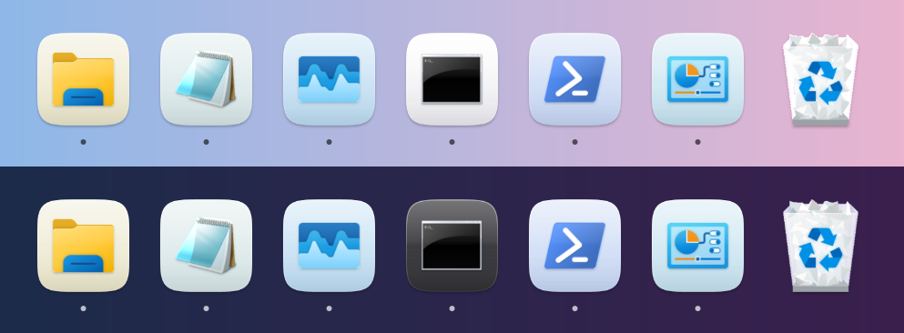
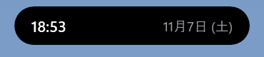
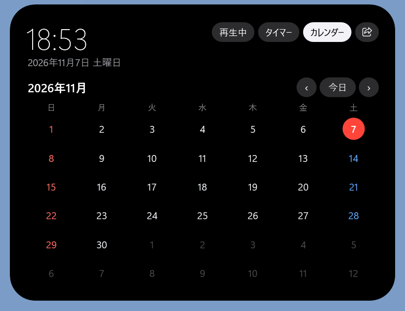
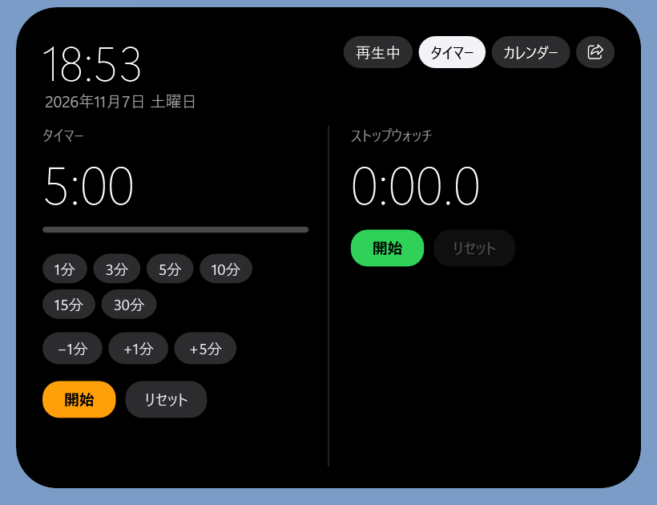
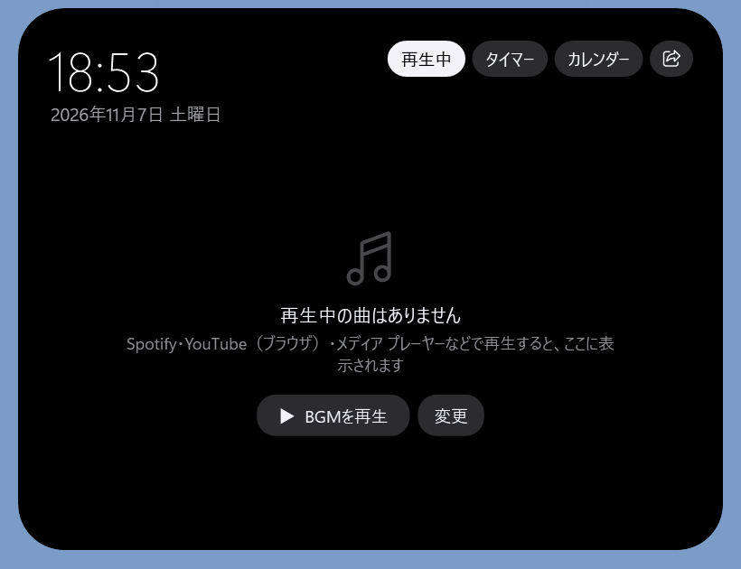
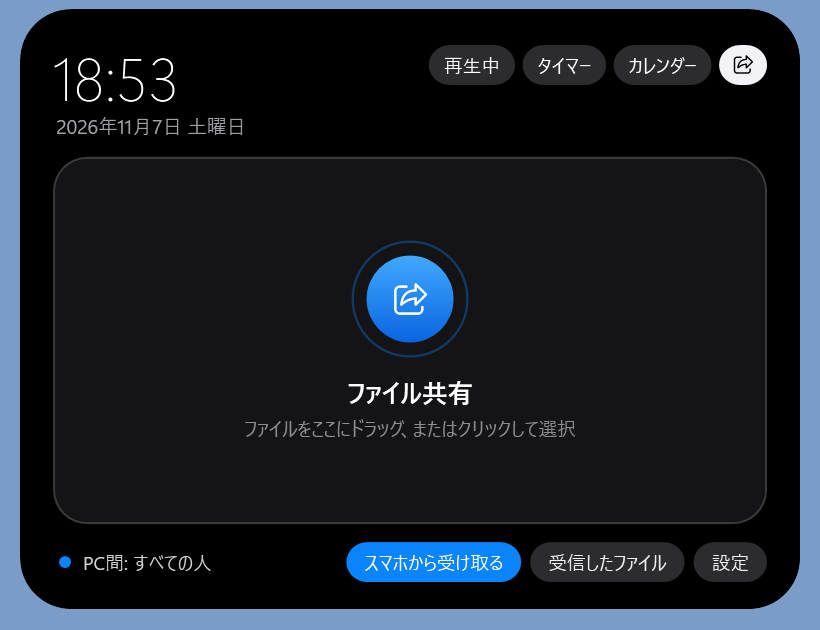
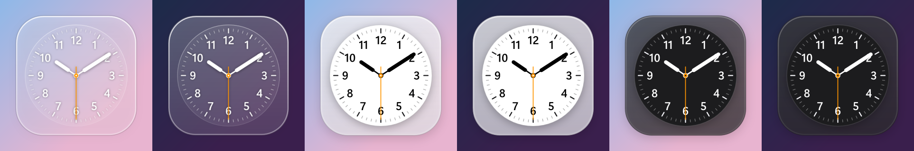

# Islandock

Windows のデスクトップに、拡大アニメーション付きの **Dock** と、画面上部の **アイランド型バー** を追加するツールです。



## できること

### Dock（画面下）
- マウスを近づけるとアイコンがふわっと拡大
- クリックでアプリ起動（起動時にアイコンが跳ねる）
- 起動中のアプリは下に点が付く。起動中ならクリックでそのウィンドウを前面に出す
- exe やショートカットを Dock に **ドラッグ＆ドロップ** で追加
- アイコンを右クリック → 開く / ファイルの場所 / 左右に移動 / 削除
- Dock の背景を右クリック → アプリを追加 / 時計ウィジェット / 設定ファイル / 終了

### アイランド（画面上）
画面のいちばん上の真ん中にマウスを少し止めると出てきます。
- **再生中**: Spotify・YouTube（ブラウザ）などで再生中の曲の表示と操作
- **タイマー / ストップウォッチ**
- **カレンダー**
- **ファイル共有**: Windows の近距離共有でファイルを送る / スマホから QR コードで PC にファイルを送る
- 充電・音量・消音などのお知らせ、マイク・カメラ使用中のランプ

ふだんは小さなカプセル（時刻と日付）で、マウスを乗せると広がります。



| カレンダー | タイマー / ストップウォッチ |
|---|---|
|  |  |
| **再生中** | **ファイル共有** |
|  |  |

### 時計ウィジェット
Dock の背景を右クリック →「時計ウィジェットを表示」で、デスクトップにアナログ時計を置けます（スタイルは6種類）。



## 動かし方
[.NET 10 SDK](https://dotnet.microsoft.com/download) を入れてから、`start.bat` をダブルクリックするか、このフォルダでターミナルを開いて:

```
dotnet run
```

## BGM（作業用の再生リスト）
アイランドを開き「再生中」タブ →「BGM の再生リストを設定」を押して、
YouTube の再生リストの URL を貼り付けて保存すると、「▶ BGMを再生」でいつでも開けます。

## 設定ファイル
設定は `%APPDATA%\Islandock\` に保存されます（`dock.json` / `island.json` / `clock.json`）。

## 注意
- **スマホから受け取る** 機能は、PC の中に小さな Web サーバーを立てます。通信は暗号化されていない（http）ので、
  **家など信頼できる Wi-Fi でだけ** 使ってください。使い終わったら「受信を止める」を押してください（15 分使わないと自動で止まります）。
- Windows のタスクバーと重なって見づらい場合は、
  「設定 → 個人用設定 → タスクバー → タスクバーの動作 → タスクバーを自動的に隠す」をオンにしてください。

## ライセンス
MIT ライセンスです。くわしくは [LICENSE](LICENSE) を見てください。

使っているライブラリ:
- [QRCoder](https://github.com/codebude/QRCoder)（MIT ライセンス）— スマホ受信用の QR コードの作成

## 商標について
Apple、Mac、macOS、iPhone、AirDrop、Dynamic Island は Apple Inc. の商標です。
Windows は Microsoft Corporation の商標です。画面写真に写っているアイコンは Windows に付属するアプリのものです。YouTube は Google LLC の商標です。
このソフトウェアは個人が作った非公式のもので、Apple Inc.・Microsoft Corporation・Google LLC とは関係がなく、これらの会社が承認・提供しているものではありません。
